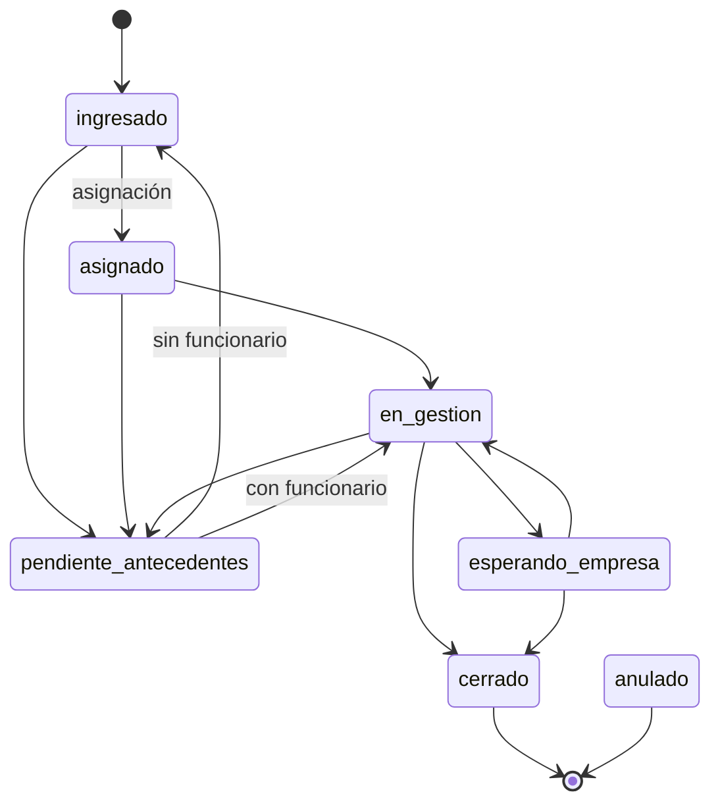

# API REST del backend — propuesta de contrato

> **Estado: propuesta.** Rutas, campos, roles, estados y reglas de plazo deben
> confirmarse con el equipo antes de integrarlos (ver `docs/conventions.md`).
> Prototipo académico ficticio; sin relación institucional con SERNAC.

- Base: `http://127.0.0.1:8000/api/v1`. Documentación interactiva en `/docs`.
- Contrato completo en [`openapi.json`](openapi.json), generado con
  `python -m scripts.exportar_openapi` desde `backend/`. Regenerarlo al cambiar la API.
- JSON en UTF-8. Fechas con hora en ISO 8601 UTC (`2026-10-26T18:00:00Z`);
  fechas sin hora como `AAAA-MM-DD`. Los plazos se calculan con la fecha local
  de Chile (`America/Santiago`).

## Autenticación

1. `POST /auth/login` con `{"correo": "...", "contrasena": "..."}`.
2. La respuesta trae `access_token`, `expira_en` y `usuario` (con su `rol`).
3. Enviar `Authorization: Bearer <access_token>` en las demás solicitudes.
   En `/docs`, usar el botón **Authorize** y pegar solo el token.

El token dura 8 horas (`JWT_MINUTOS_EXPIRACION`). No hay renovación ni cierre
de sesión en el servidor: para salir, el frontend descarta el token.

### Usuarios de demostración (solo almacenamiento en memoria)

Todos con la contraseña ficticia `demo1234`:

| Correo                       | Rol           |
| ---------------------------- | ------------- |
| `admin@reclamos.test`        | administrador |
| `supervisor@reclamos.test`   | supervisor    |
| `funcionario1@reclamos.test` | funcionario   |
| `funcionario2@reclamos.test` | funcionario   |
| `funcionario3@reclamos.test` | funcionario   |

Se cargan además 13 reclamos ficticios con fechas relativas al día actual, de
modo que siempre hay casos en plazo, por vencer, vencidos, cerrados y anulados.
Los datos se pierden al reiniciar el servidor.

## Endpoints

| Método | Ruta                         | Roles          | Uso                                                         |
| ------ | ---------------------------- | -------------- | ----------------------------------------------------------- |
| POST   | `/auth/login`                | público        | Iniciar sesión                                              |
| GET    | `/auth/me`                   | todos          | Usuario actual y su rol                                     |
| GET    | `/usuarios?rol=&activo=`     | admin, superv. | Listar usuarios (asignables: `rol=funcionario&activo=true`) |
| POST   | `/usuarios`                  | admin          | Crear usuario                                               |
| PATCH  | `/usuarios/{id}`             | admin          | Cambiar nombre, rol, activo o contraseña                    |
| GET    | `/reclamos`                  | todos\*        | Listado paginado con filtros                                |
| POST   | `/reclamos`                  | todos          | Registrar reclamo (queda `ingresado`)                       |
| GET    | `/reclamos/{id}`             | todos\*        | Detalle                                                     |
| PATCH  | `/reclamos/{id}`             | gestor o asig. | Corregir datos de un reclamo activo                         |
| POST   | `/reclamos/{id}/estado`      | gestor o asig. | Cambiar estado según el flujo                               |
| POST   | `/reclamos/{id}/asignacion`  | admin, superv. | Asignar o reasignar funcionario                             |
| POST   | `/reclamos/{id}/gestiones`   | gestor o asig. | Registrar una gestión (nota, llamada, oficio)               |
| GET    | `/reclamos/{id}/seguimiento` | todos\*        | Historial cronológico del reclamo                           |
| GET    | `/asignaciones/carga`        | admin, superv. | Reclamos activos por funcionario                            |
| GET    | `/plazos/alertas`            | todos\*        | Activos vencidos o por vencer, por urgencia                 |
| GET    | `/plazos/resumen`            | todos\*        | Conteos a la fecha de corte                                 |

\* El funcionario solo ve los reclamos asignados a él o registrados por él; los
demás responden 404. "Gestor" = administrador o supervisor; "asig." = el
funcionario asignado al reclamo.

### Filtros de `GET /reclamos`

`estado` (repetible: `?estado=en_gestion&estado=esperando_empresa`),
`funcionario_id`, `sin_asignar=true`, `situacion_plazo` (`en_plazo`,
`por_vencer`, `vencido`; solo activos), `q` (busca en folio, consumidor,
empresa y categoría), `orden` (`fecha_ingreso_desc` por defecto,
`fecha_ingreso_asc`, `fecha_limite_asc`, `fecha_limite_desc`), `pagina` (desde 1)
y `por_pagina` (1–100, por defecto 20).

Respuesta: `{"items": [...], "total": 13, "pagina": 1, "por_pagina": 20, "paginas": 1}`.

Cada reclamo incluye `funcionario` (`{id, nombre, rol}` o `null`) y `plazo`:

```json
{
  "fecha_limite": "2026-11-15",
  "dias_transcurridos": 0,
  "dias_restantes": 20,
  "situacion": "en_plazo"
}
```

`situacion`: `en_plazo`, `por_vencer`, `vencido`, `cerrado_en_plazo`,
`cerrado_fuera_de_plazo` o `no_aplica` (anulados). `dias_restantes` es `null`
cuando el reclamo terminó.

## Flujo de estados (propuesta)

Los nombres coinciden con `frontend/src/features/reclamos/estados.ts`.



- Cualquier estado activo puede pasar a `anulado` (solo administrador o supervisor).
- `asignado` solo se alcanza con `POST /reclamos/{id}/asignacion`. Reasignar no
  cambia el estado.
- `en_gestion`, `esperando_empresa` y `cerrado` exigen funcionario asignado.
- `cerrado`, `anulado` y `pendiente_antecedentes` exigen `comentario`. Al cerrar
  o anular, el comentario queda como `resultado` y se registra `fecha_cierre`.
- `cerrado` y `anulado` son finales: no admiten cambios, gestiones ni asignaciones.

Las reglas están en `backend/app/services/flujo_estados.py`.

## Control de plazos (propuesta)

- Plazo: `PLAZO_DIAS` = 20 días corridos desde la fecha local de ingreso. La
  fecha límite se guarda al registrar el reclamo, así que cambiar la
  configuración no altera los reclamos existentes.
- Por vencer: activos con 0 a `DIAS_ALERTA` = 3 días restantes (incluido hoy).
- Vencido: activos cuya fecha límite ya pasó.
- Cerrado en plazo: fecha local de cierre ≤ fecha límite.
- Los anulados no se evalúan (`no_aplica`).

Son las mismas definiciones descritas en `analytics/README.md` (excluir anulados,
días corridos). Las reglas están en `backend/app/services/plazos.py`.

## Errores

| Código | Cuándo                                            | `codigo`                           |
| ------ | ------------------------------------------------- | ---------------------------------- |
| 401    | Sin token, token inválido o usuario desactivado   | `no_autenticado`                   |
| 403    | El rol no permite la acción                       | `permiso_denegado`                 |
| 404    | No existe o no es visible para el usuario         | `no_encontrado`                    |
| 409    | No válido en el estado actual (p. ej. transición) | `conflicto`, `transicion_invalida` |
| 422    | Incumple una regla de negocio                     | `regla_negocio`                    |

Formato: `{"detail": "Mensaje para mostrar", "codigo": "transicion_invalida"}`.
Los errores de validación de campos (422 de FastAPI) mantienen su formato
estándar: `detail` es una lista con la ubicación y el mensaje de cada campo.

## Para cada parte del equipo

### Frontend

- Centralizar las llamadas en `frontend/src/services/` con la base
  `http://127.0.0.1:8000/api/v1` (por ejemplo, en `VITE_API_URL`; es pública,
  nunca guardar secretos ahí). CORS ya permite `http://localhost:5173` y
  `http://127.0.0.1:5173`.
- Los tipos TypeScript se pueden generar desde `openapi.json`, por ejemplo con
  `openapi-typescript`, o escribirse a mano a partir de `/docs`.
- `GET /plazos/resumen`, `GET /plazos/alertas` y `GET /asignaciones/carga`
  cubren los datos operativos del panel. Los KPI mensuales son de Power BI.

### Base de datos

El backend ya funciona con repositorios en memoria. Para conectarlo a PostgreSQL
no hay que tocar servicios ni routers:

1. Definir el modelo lógico y los modelos SQLAlchemy en `backend/app/models/`,
   importarlos en `app/models/__init__.py` y generar la migración con Alembic.
2. Implementar las interfaces de `backend/app/repositories/base.py`
   (`UsuarioRepository`, `ReclamoRepository`, `EventoRepository`), por ejemplo en
   `app/repositories/sql/`, convirtiendo entre modelos y las entidades de
   `app/domain/entidades.py`.
3. En `app/api/deps.py` (`get_repositorios`), crear esos repositorios con la
   sesión de `app.db.session.get_db` cuando `ALMACENAMIENTO=sql`, y quitar el
   `NotImplementedError` de `app/main.py`.

Datos que necesita el backend (los nombres de columnas los decide el equipo de BD):

- **Usuario**: nombre, correo único, rol, hash de contraseña, activo.
- **Reclamo**: folio único, datos del consumidor (nombre, RUT, correo, teléfono),
  empresa (nombre, RUT), categoría, descripción, canal, estado, funcionario
  asignado (FK opcional), registrado por (FK), fecha de ingreso, fecha límite,
  fecha de cierre, resultado, fecha de actualización.
- **Evento de seguimiento**: reclamo (FK), tipo, fecha, usuario (FK), detalle,
  estado anterior y nuevo, funcionario anterior y nuevo. Es un historial de solo
  inserción: sirve para trazabilidad y para KPI de tiempos por estado.

Las consultas que necesita `buscar` están en `FiltroReclamos`: filtros por
estado, funcionario, sin asignar, visibilidad del funcionario, rango de fecha
límite y texto. Conviene indexar `estado`, `funcionario_id` y `fecha_limite`.

### Power BI

Power BI no consume esta API: leerá PostgreSQL con una cuenta de solo lectura y
vistas SQL (ver `analytics/README.md`). Para que las cifras coincidan con la
aplicación, las vistas deben usar las mismas reglas de plazo descritas arriba,
la fecha límite guardada en cada reclamo y la tabla de eventos para los tiempos
de cada etapa.
