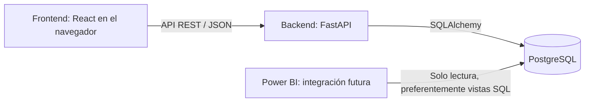

# Arquitectura del proyecto

Monorepo con una aplicación cliente-servidor de tres capas. Es un prototipo
académico ficticio de la UCN, sin vínculo institucional con SERNAC.

- **Presentación — frontend:** React, TypeScript, Vite, Tailwind CSS y React Router.
  Presentación e interacción; sin credenciales de PostgreSQL ni reglas de negocio.
  `app/` centraliza rutas; `pages/` contiene vistas; `features/` agrupa el trabajo
  por función; `components/ui/` y `components/layout/` alojan piezas compartidas;
  `services/` centraliza las llamadas a la API.
- **Aplicación — backend:** FastAPI y Pydantic exponen y validan la API.
  `api/v1/` agrupa routers, `schemas/` los contratos de entrada y salida,
  `services/` las reglas de negocio, `repositories/` el acceso a datos y
  `models/` los modelos SQLAlchemy.
- **Datos — PostgreSQL:** persistencia e integridad. SQLAlchemy prepara conexiones;
  Alembic administra los cambios del esquema junto con los modelos acordados.
- **Analítica futura:** Power BI consultará PostgreSQL con una cuenta separada de
  solo lectura, preferentemente mediante vistas SQL. Esa cuenta, las vistas y
  los seis KPI se definirán después. No usar la cuenta de desarrollo en Power BI.

El flujo futuro es navegador → API REST JSON → backend → PostgreSQL; la respuesta
regresa por la misma API. El navegador nunca se conecta directamente a la base.
Los procesos frontend y backend se ejecutan en el equipo local; Compose solo
levanta PostgreSQL, publicado en `127.0.0.1`, con un volumen persistente.

## Punto de partida del desarrollo

La estructura inicial incluye `/health`, que comprueba el proceso HTTP y funciona
sin PostgreSQL; no indica disponibilidad de la base. Todavía no hay endpoints de
negocio, tablas ni migraciones, y el frontend no realiza llamadas HTTP. El equipo
incorporará estas piezas durante el desarrollo, utilizando `/api/v1` como prefijo
propuesto para los endpoints. Mantener esta documentación al día con los avances.

## Base técnica elegida

Node.js 24 LTS; React 19, React Router 8, Vite 8, Tailwind CSS 4 y TypeScript 6.0.
TypeScript se mantiene en 6.0 por compatibilidad con `typescript-eslint`.
Para la propuesta de sistema de diseño (ver abajo) el frontend suma three.js,
React Three Fiber y drei (fondo 3D), Motion (animaciones), NumberFlow (cifras
animadas) y Lucide (íconos).
Backend con Python 3.12–3.14, FastAPI, Pydantic 2, SQLAlchemy 2.1,
Psycopg 3 y Alembic. Compose utiliza PostgreSQL 18.
Las versiones concretas quedan en `frontend/package-lock.json` y
`backend/requirements.txt`; no se incorporan versiones preliminares.

Se utiliza la integración oficial de [Tailwind con Vite](https://tailwindcss.com/docs/installation/using-vite),
[React Router declarativo](https://reactrouter.com/start/declarative/installation),
[configuración de FastAPI con Pydantic Settings](https://fastapi.tiangolo.com/advanced/settings/)
y la [imagen oficial de PostgreSQL](https://hub.docker.com/_/postgres).

## Propuestas pendientes de confirmar por el equipo

- URLs provisionales de las vistas, prefijo `/api/v1`, formato de errores,
  contratos JSON, campos, identificadores y mecanismo de autenticación.
- Modelo de datos, roles, estados, reglas de plazos y asignación. No están definidos.
- Acceso síncrono a PostgreSQL con Psycopg como punto de partida; revisar si una
  necesidad concreta justifica otro enfoque.
- Definición, fuentes y actualización de los seis KPI; vistas y permisos de lectura.
- Identidad visual y componentes comunes. **Propuesta en revisión:** sistema de
  diseño "islas de vidrio" (glassmorphism sobrio, solo tema claro) sobre un cielo
  gris acero con objetos 3D translúcidos. Sus tokens están en
  `frontend/src/styles/global.css` (`@theme` de Tailwind y utilidades
  `glass-shell`, `glass-panel`, `glass-tile`, `glass-strong`, `glass-island`).
  Componentes iniciales: `components/layout/Backdrop` (escena 3D, carga diferida y
  respaldo en CSS si no hay WebGL), `components/layout/AppShell` y
  `components/ui/Glass`. Falta que el equipo la confirme.
- Reparto de tareas entre los cinco integrantes y responsables de archivos compartidos.
  Propuesta inicial: Gael y Marianela trabajan los mockups del frontend; los otros
  tres integrantes acuerdan los módulos del backend antes de comenzar.
