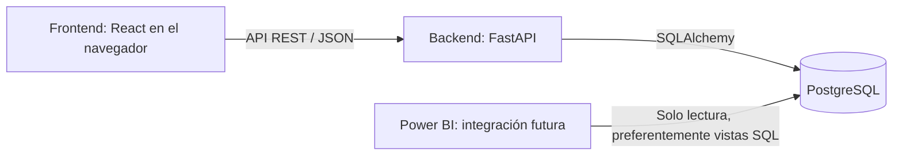
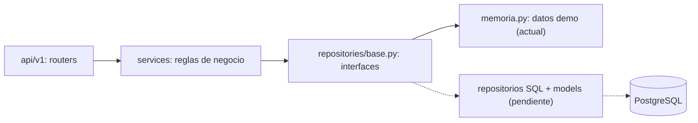

# Arquitectura del proyecto

Monorepo con una aplicación cliente-servidor de tres capas. Es un prototipo
académico ficticio de la UCN, sin vínculo institucional con SERNAC.

- **Presentación — frontend:** React, TypeScript, Vite, Tailwind CSS y React Router.
  Presentación e interacción; sin credenciales de PostgreSQL ni reglas de negocio.
  `app/` centraliza rutas; `pages/` contiene vistas; `features/` agrupa el trabajo
  por función; `components/ui/` y `components/layout/` alojan piezas compartidas;
  `services/` centraliza las llamadas a la API.
- **Aplicación — backend:** FastAPI y Pydantic exponen y validan la API.
  `api/v1/` agrupa routers, `schemas/` los contratos de entrada y salida,
  `services/` las reglas de negocio, `repositories/` el acceso a datos y
  `models/` los modelos SQLAlchemy. **Propuesta:** `domain/` contiene las
  entidades y enumeraciones que comparten servicios y repositorios, sin
  depender de FastAPI ni de SQLAlchemy.
- **Datos — PostgreSQL:** persistencia e integridad. SQLAlchemy prepara conexiones;
  Alembic administra los cambios del esquema junto con los modelos acordados.
- **Analítica futura:** Power BI consultará PostgreSQL con una cuenta separada de
  solo lectura, preferentemente mediante vistas SQL. Esa cuenta, las vistas y
  los seis KPI se definirán después. No usar la cuenta de desarrollo en Power BI.

El flujo futuro es navegador → API REST JSON → backend → PostgreSQL; la respuesta
regresa por la misma API. El navegador nunca se conecta directamente a la base.
Los procesos frontend y backend se ejecutan en el equipo local; Compose solo
levanta PostgreSQL, publicado en `127.0.0.1`, con un volumen persistente.

## Punto de partida del desarrollo

La estructura inicial incluye `/health`, que comprueba el proceso HTTP y funciona
sin PostgreSQL; no indica disponibilidad de la base. Todavía no hay tablas ni
migraciones, y el frontend no realiza llamadas HTTP. Mantener esta documentación
al día con los avances.

## Base del backend (propuesta)

Endpoints de negocio bajo `/api/v1` para los servicios acordados: login, gestión
de reclamos, asignación de funcionarios, seguimiento y control de plazos. El
contrato, los roles, el flujo de estados y las reglas de plazo están en
[api/README.md](api/README.md) y deben confirmarse con el equipo.

- **Autenticación:** JWT firmado con HS256 (PyJWT) y enviado como
  `Authorization: Bearer`. Contraseñas con scrypt de la biblioteca estándar.
  Roles propuestos: administrador, supervisor y funcionario.
- **Datos intercambiables:** los servicios dependen de las interfaces de
  `repositories/base.py`. Hoy se usa la implementación en memoria con datos
  ficticios (`ALMACENAMIENTO=memoria`), para que el frontend pueda integrarse
  sin esperar la base. El equipo de BD implementa los repositorios SQL con sus
  modelos y migraciones; el único punto que cambia es `get_repositorios` en
  `api/deps.py`. La sesión por solicitud ya está en `db/session.get_db`.
- **Reglas de negocio:** `services/flujo_estados.py` (transiciones),
  `services/plazos.py` (cálculo puro de plazos), `services/permisos.py`
  (acceso por rol). La fecha límite se guarda al registrar el reclamo.
- **Trazabilidad:** cada creación, actualización, asignación, cambio de estado
  y gestión agrega un evento de seguimiento, base para la vista de historial y
  para los tiempos por etapa que pueda usar Power BI.
- **Hora:** se guarda en UTC; los días de plazo se cuentan con la fecha local
  de `America/Santiago` (`core/reloj.py`, reemplazable en las pruebas).
- **Contrato:** `docs/api/openapi.json` se regenera con
  `python -m scripts.exportar_openapi` para que el frontend genere tipos.

## Base técnica elegida

Node.js 24 LTS; React 19, React Router 8, Vite 8, Tailwind CSS 4 y TypeScript 6.0.
TypeScript se mantiene en 6.0 por compatibilidad con `typescript-eslint`.
Para la propuesta de sistema de diseño (ver abajo) el frontend usa Motion
(transiciones de selección) y Lucide (íconos). El fondo decorativo usa CSS
estático; no se cargan Three.js, React Three Fiber, drei ni NumberFlow.
Backend con Python 3.12–3.14, FastAPI, Pydantic 2, SQLAlchemy 2.1,
Psycopg 3 y Alembic. Compose utiliza PostgreSQL 18.
Las versiones concretas quedan en `frontend/package-lock.json` y
`backend/requirements.txt`; no se incorporan versiones preliminares.

Se utiliza la integración oficial de [Tailwind con Vite](https://tailwindcss.com/docs/installation/using-vite),
[React Router declarativo](https://reactrouter.com/start/declarative/installation),
[configuración de FastAPI con Pydantic Settings](https://fastapi.tiangolo.com/advanced/settings/)
y la [imagen oficial de PostgreSQL](https://hub.docker.com/_/postgres).

## Propuestas pendientes de confirmar por el equipo

- URLs provisionales de las vistas, prefijo `/api/v1`, formato de errores,
  contratos JSON, campos, identificadores y mecanismo de autenticación. La
  propuesta del backend está en [api/README.md](api/README.md).
- Modelo de datos, roles, estados, reglas de plazos y asignación. El backend
  propone roles, flujo de estados y plazos (20 días corridos, alerta a 3 días);
  el modelo de datos sigue pendiente.
- Acceso síncrono a PostgreSQL con Psycopg como punto de partida; revisar si una
  necesidad concreta justifica otro enfoque.
- Definición, fuentes y actualización de los seis KPI; vistas y permisos de lectura.
- Identidad visual y componentes comunes. **Propuesta en revisión:** sistema de
  diseño "islas de vidrio" (glassmorphism sobrio, solo tema claro) sobre un cielo
  gris acero con formas estáticas translúcidas. Sus tokens están en
  `frontend/src/styles/global.css` (`@theme` de Tailwind y utilidades
  `glass-shell`, `glass-panel`, `glass-tile`, `glass-strong`).
  Componentes iniciales: `components/layout/Backdrop` (decoración estática en CSS),
  `components/layout/AppShell` y
  `components/ui/Glass`. Falta que el equipo la confirme.
- Reparto de tareas entre los cinco integrantes y responsables de archivos compartidos.
  Propuesta inicial: Gael y Marianela trabajan los mockups del frontend; los otros
  tres integrantes acuerdan los módulos del backend antes de comenzar.

## Ajuste de rendimiento aplicado

Se reemplazó el fondo WebGL por círculos y un aro estáticos con degradados,
bordes y sombras CSS. La identidad visual sigue siendo una propuesta pendiente
de confirmación del equipo; el ajuste técnico evita renderizar decoración
continuamente en todas las rutas.

El desenfoque se limita a `glass-shell` y `glass-panel`, a 12 px. Los controles
y etiquetas mantienen transparencia sin filtros. Se retiraron los vaivenes,
pulsos y filtros SVG del panel, las entradas escalonadas y los contadores al
montar. Cifras y gráficos se presentan directamente; se conservan transiciones
breves para selección, hover y foco, respetando movimiento reducido.

`Glass` recibe atributos HTML de `section`; ya no recibe propiedades de Motion
ni `float`, `floatDelay` o `enter`. `TrendCard` tampoco recibe `enter`.
Los contratos REST y el backend no cambian. La validación y sus límites se
registran en [performance.md](performance.md).

## Propuesta de mockups alineados con los KPI

Para las capturas académicas, el panel operativo resume los seis KPI y la ruta
`/indicadores` los desarrolla en dos vistas: plazos y resolución (KPI 1 y 3) y
pendientes y carga (`?vista=seguimiento`, KPI 2, 4, 5 y 6). Se reutilizan las
superficies, tendencias y componentes del diseño actual, sin dependencias nuevas.

El escenario compartido está en `frontend/src/features/dashboard/mockData.ts`:
septiembre de 2026 para los indicadores mensuales y corte al 26 de octubre de
2026 para los diarios. Los cinco estados activos se presentan completos en
Indicadores; el panel los agrupa en revisión inicial (Ingresado y Pendiente de
antecedentes), gestión interna (Asignado y En gestión) y espera de empresa.
Los listados de alertas son muestras explícitas del total. Las alertas son
subconjuntos de los activos, no categorías sumables al total de pendientes.

Esta es una propuesta visual, no un acuerdo de contratos REST ni una integración
con Power BI. No incorpora reglas de negocio al frontend: las cifras son
respuestas ficticias fijas y las interacciones solo filtran las muestras. Los
cálculos reales, datos de origen y frecuencia de actualización siguen pendientes
de coordinación entre backend y analítica. El control complementario de
trazabilidad no se presenta como un séptimo KPI.

### Legibilidad y componentes de los indicadores

Se subió la escala tipográfica porque el 76 % del texto estaba en 12 px y las
etiquetas de las burbujas se renderizaban a unos 8 px. Ahora el contenido parte
de 13 px (`caption`), los rótulos de eje de 11 px (`axis`) y la cifra principal de
48 px (`hero-number`). Los tamaños están en `rem` y la raíz crece 10 %, 20 % o
50 % desde 1500, 1800 y 2400 px de ancho si el alto lo permite; la variante
`compact` adapta sus límites a esa escala. Las cifras grandes usan números
proporcionales; `tabular-nums` queda para columnas. Es una propuesta de ajuste
a los tokens publicados: si el equipo la confirma, hay que actualizar también el
sistema de diseño publicado.

Nuevos componentes compartidos en `components/ui/`: `BarList` (barras
horizontales de una sola escala, para KPI 2 y KPI 5) y `RingStat` (anillo
estático). La muestra de alertas del panel se filtra con `SegmentedControl`. Los
gráficos de `features/dashboard/` ahora derivan sus rótulos de los datos:
`TrendCard` muestra un punto por mes con su valor al apuntarlo, y `CierresPorMes`
(Recharts) muestra el volumen de cierres que sustenta KPI 1 y KPI 3. Las cifras de apoyo salen
de `mockData.ts` y `npm run check` verifica su coherencia.

### Recharts y color de estados

`features/indicadores/CierresPorMes` usa Recharts 3.10.1 (versión exacta en
`frontend/package.json`) como prueba acotada: barras sin animación, último mes
destacado y tooltip propio. Suma unos 100 kB gzip al JavaScript de la
aplicación; si el equipo no la adopta, se revierte volviendo a `GlassBars` y
quitando `recharts` y `react-is`.

Las píldoras de estado y plazo ya no llevan un degradado teñido ni un borde de
color: son vidrio neutro y el tono vive solo en el ícono o en un punto de 8 px
(`PlazoChip`). El anillo de avance del plazo se retiró.
